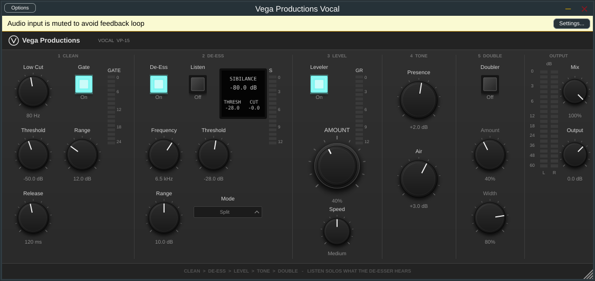

# Vega Productions Vocal (VP-15)

A complete vocal chain in one plugin: clean → de-ess → level → tone → double. Pairs with Vega Productions Autotune.



## Download
- **Windows (FL Studio):** https://github.com/DJVega70/vega-vocal/releases/latest/download/VegaProductions-Vocal-Windows-VST3.zip
- **macOS:** https://github.com/DJVega70/vega-vocal/releases/latest/download/VegaProductions-Vocal-macOS-VST3-AU.zip

## Modules
1. **Clean** — Low Cut (rumble/pops) and a breath/noise **Gate** (downward expander with range, so gaps get quieter instead of chopped).
2. **De-Ess** — frequency 3–12 kHz, threshold, range; **Split** mode only turns down the "ess" band, **Wideband** dips the whole voice. **Listen** solos what the de-esser hears so you can find the harsh frequency. Live sibilance read-out.
3. **Level** — one-knob soft-knee leveler with auto makeup and Slow/Medium/Fast speed — evens out verses and hooks.
4. **Tone** — Presence (3.2 kHz) and Air (12 kHz shelf).
5. **Double** — two delayed, slightly detuned copies spread left/right for an instant double-track (works great on mono vocals).

Mix, Output, gain-reduction meters for gate, de-esser and leveler. Resizable.

## Building
```
cmake -B build -DVEGA_TESTS=ON
cmake --build build --config Release --target VegaVocal_VST3 VegaVocalTest
```
